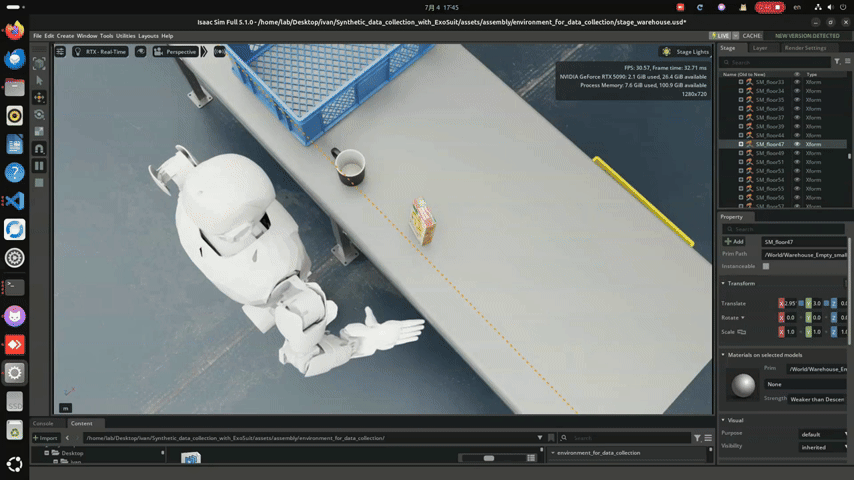

# Synthetic Data Collection with ExoSuit

This project is part of my Master's thesis on behavior foundation models for humanoid manipulation.

The goal of this project is to use a physical ExoSuit to control a humanoid robot in NVIDIA Isaac Sim and collect synthetic manipulation data.

## Normal collection launch

In the existing Isaac container, with Jazzy, the built ROS2 workspace, tmux and
Isaac Sim installed at `/isaac-sim`, run these two commands in separate terminals.
No environment prefixes or manual sourcing are required. Build dependencies once
using the [setup guide](exo2isaacsim/src/isaac_eff_control/README.md#build-and-launch-in-the-existing-isaac-sim-container).

```bash
# Terminal 1
cd /workspace/Synthetic_data_collection_with_ExoSuit
bash launch_bfm_isaac.sh
```

```bash
# Terminal 2 (launch last)
cd /workspace/Synthetic_data_collection_with_ExoSuit
bash start_isaac_control.sh
```

The selected scene opens automatically while STOPPED. Wait for the extension's
`[BFM PLAN READY]` message before pressing PLAY. The existing ROS1/ZMQ/ROS2 bridge
must be running in its deployment; these scripts consume its semantic topics.
They do not create another bridge or rebuild the workspace.

The attached tmux `main` window has three equal horizontal panes:
**ARM / JOINTS**, **HAND / GRIPPERS**, **RECORDING**, in that order. The actual
arm controller, hand controller and recorder each run once in these panes.
ARM/HAND show WAITING, ACTIVE on valid input, STOPPED after one second without
input, and ERROR for malformed input. Only transitions are printed. HAND watches
the raw semantic bridge input for status, because held gateway targets continue
when input stops; interpolation remains at 50 Hz. ACTIVE describes command flow,
not measured robot motion. Recording shows WAITING, RECORDING with the episode
name, STOPPED after finalization/sidecar save, or ERROR on failure.

Use normal tmux navigation to reach `backend`: the existing bounded BFM gateway
runs there, beside detailed rosbag output (`records/rosbag2.log`). Warnings and
errors remain visible. Ctrl-C in a worker pane forwards SIGINT and waits for
cleanup; the recorder finalizes its MCAP and outcome. Relaunching the control
script interrupts all old workers and waits up to 40 seconds before replacing
the session; if cleanup is still running it preserves the session and fails.
Unexpected worker exits are retained and announce ERROR in the main window.

Both scripts internally fix collection mode to enabled, semantic inputs,
degree conversion, domain 0 and SUBNET discovery, ignoring inherited production
overrides. Scene defaults and episode-generated descriptors remain authoritative.
Lower-level configuration APIs remain available for debugging outside these
production scripts. Contract v3, bounded action semantics, cameras, physics and
task behavior are unchanged.

## Sorting scenarios

Scenario resources and configurations now live together:

```text
models/stages/
  v1_manipulation_one_side_right/
    stage_sorting_v1.usd
    fruit_pool.usda
    sorting_scene.json
  v1_manipulation_ambidextrous/
    stage_manipulation.usda
    sorting_scene.json
  v1_manipulation_orange_left/
    stage_manipulation.usda
    things_pool.usda
    sorting_scene.json
  sorting_experimental/
    stage_sorting_v2.usda
    stage_sorting_v3.usda
    things_pool.usda
    sorting_scene_v3.json
```

`v1_manipulation_one_side_right` preserves the original three selectable fruits (avocado, lemon,
orange), restricted right-side spawn region, parked pomegranate and original
robot collision configuration. `sorting_experimental` preserves the current
five-object V3 pool, bidirectional layouts and V2 collision override. Neither
scenario's randomization or physical settings were changed by this move.

```bash
# Stable scenario used for the original demonstrations
SCENARIO=v1_manipulation_one_side_right bash launch_bfm_isaac.sh

# New experimental scenario
SCENARIO=sorting_experimental bash launch_bfm_isaac.sh

# Backward-compatible default: experimental
bash launch_bfm_isaac.sh

# Equivalent positional interface
bash launch_bfm_isaac.sh v1_manipulation_one_side_right
```

Conflicting environment/argument selections and unknown names fail before Isaac
starts. PLAY remains manual. Run `bash start_isaac_control.sh` in the other
terminal as before; it does not need the selector. The extension chooses the
configuration from the opened stage using the shared registry in
`isaac_eff_control/scenarios.py`. Its existing episode descriptor now carries
the active configuration and task parameters to the recorder. The recorder
verifies the configuration hash against its installation and refuses mismatches.
Thus a separate terminal cannot accidentally record legacy metadata for V3.

`v1_manipulation_ambidextrous` sublayers the stable V1 stage and the existing
experimental `things_pool.usda`; it does not load experimental robot physics,
collision overrides or saved articulation state. Its configuration reuses the
unchanged `things_v3` planner: A/B side selection, independent randomized object
and container positions, yaw, support, clearance and obstacle rejection.
The five upstream objects are apple_02, lunchbag, ketchup_bottle, avocado, orange2.

```bash
SCENARIO=v1_manipulation_ambidextrous bash launch_bfm_isaac.sh
# Equivalent positional selector:
bash launch_bfm_isaac.sh v1_manipulation_ambidextrous
```

There are exactly four scenario directories. The old `sorting_v1` directory
and selector are removed, without compatibility aliases or symlinks. Experimental
V2 and pool parking references now point directly to the renamed stable resources;
only those paths and the affected pool checksum change. Composition order and
experimental behavior remain unchanged. Shared meshes/textures remain under
`models/robots` and `models/addons`. The stable USD and fruit pool are byte-identical
moves. Controllers, cameras, task outcomes, collection lifecycle and randomization
code are unchanged. The default launch remains `sorting_experimental`.

### Single-object orange-left collection

`v1_manipulation_orange_left` simplifies collection to the existing `orange2`
asset. It reuses the stable V1 robot/environment and a local single-body pool;
source geometry, materials, mass/inertia and the existing success detector are
unchanged. Unlike ambidextrous V4's random A/B layouts, `orange_left_v1` requires
`fixed_layout: "B"`: orange footprint centre in the established **left** region,
container footprint centre in the established **right** region. These are the
planner's existing spatial conventions, not image coordinates. Both positions
remain independently randomized, with configured random orange yaw, original
support/clearance/obstacle checks and unchanged container orientation/Z.

```bash
cd /workspace/Synthetic_data_collection_with_ExoSuit/exo2isaacsim
source /opt/ros/jazzy/setup.bash
colcon build --packages-select dynamic_biped isaac_eff_control --symlink-install
source install/setup.bash
cd ..
bash launch_bfm_isaac.sh v1_manipulation_orange_left
# In a second terminal:
bash start_isaac_control.sh
```

Wait for `[BFM PLAN READY]`, then PLAY manually. STOP prepares a new randomized
episode; PAUSE/RESUME retains the current plan. The existing reset writes only
the two preloaded actors (orange and container), with no topology changes.
Recording remains `records/record_<timestamp>_<random>/episode.json` plus the
existing `bag/` MCAP. The authoritative episode records layout B, actual poses,
`/World/Task/Things/orange2`, `/World/container_b04` and configuration/pool hashes.
The decoupled V4 action/state contracts and topics remain unchanged; no BFM
converter change or execution acknowledgements are introduced.

Static/unit tests cannot certify contacts, tabletop support from remote NVIDIA
assets, settling or live ROS recording. In Isaac, verify repeated STOP/PLAY,
left-orange/right-container placement, both arm controls and nonzero
`/bfm/state`, `/bfm/action`, `/bfm/success` plus existing camera/controller streams
in the recorded bag. Inspect `/bfm/episode` for matching identity, layout and
randomized poses; success still requires real geometric containment/residence.

After applying the migration, rebuild only the affected ROS Python package:

```bash
source /opt/ros/jazzy/setup.bash
cd exo2isaacsim
colcon build --packages-select isaac_eff_control --symlink-install
cd ..
```

Restart Isaac and collection processes. Configurations install under
`share/isaac_eff_control/scenarios/<scenario>/`; source checkouts use the canonical
JSON files above. To add a future scenario, add its directory/configuration,
register its fixed entry in `SCENARIOS`, add its config to `setup.py` data files,
and test selection, composition and episode metadata. Do not copy common assets.

## ExoSuit Control

The physical ExoSuit is used to control the humanoid robot in real time.


The same control system is used inside a simulated manipulation environment in Isaac Sim.



## ExoSuit to Isaac Sim

The physical ExoSuit sends arm and hand commands through ROS 1. These commands are transferred through a ROS1-to-ROS2 bridge and then sent to the control nodes connected to the robot model in Isaac Sim.

Arm commands from the ExoSuit are converted into joint targets for the simulated humanoid. Hand commands are mapped to the corresponding finger joints of the simulated robotic hands.

This allows the physical ExoSuit to control the humanoid model in real time and provides a simple way to collect manipulation demonstrations in simulation.

## System Architecture

The Synthetic Data Collection ROS2 interface uses `/robot/command/...` for
ExoSuit commands, `/robot/state/...` for measured state, and `/sensors/...` for
camera observations. External ROS1 topic names are preserved. See the
[topic contract and recording setup](exo2isaacsim/src/isaac_eff_control/README.md#ros2-topic-contract)
for the full mapping, internal controller topics, and legacy configuration.


