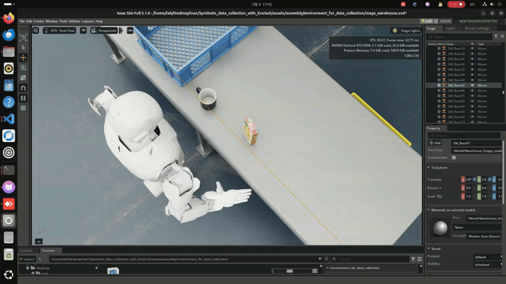

# Synthetic Data Collection with ExoSuit

This project is part of my Master's thesis on behavior foundation models for humanoid manipulation.

The goal of this project is to use a physical ExoSuit to control a humanoid robot in NVIDIA Isaac Sim and collect synthetic manipulation data.

## ExoSuit Control

The physical ExoSuit is used to control the humanoid robot in real time.

The same control system is used inside a simulated manipulation environment in Isaac Sim.

## ExoSuit to Isaac Sim

The physical ExoSuit sends arm and hand commands through ROS 1. These commands are transferred through a ROS1-to-ROS2 bridge and then sent to the control nodes connected to the robot model in Isaac Sim.

Arm commands from the ExoSuit are converted into joint targets for the simulated humanoid. Hand commands are mapped to the corresponding finger joints of the simulated robotic hands.

This allows the physical ExoSuit to control the humanoid model in real time and provides a simple way to collect manipulation demonstrations in simulation.

## System Architecture

